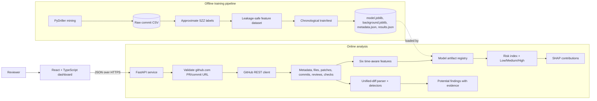

# PRRiskLens

Explainable GitHub pull request risk prediction and diff-based bug detection.

Paste a GitHub pull request or commit URL. PRRiskLens fetches the real metadata and patches, extracts six time-aware historical features, optionally scores them with a trained supervised model, explains the ranking with SHAP, and runs deterministic checks over the changed lines.

The ML ranking and the code findings are deliberately separate:

- **Historical risk signal** — a model learns associations between six features and SZZ-derived bug labels. It produces a 0–100 ranking index, not a bug probability.
- **Diff evidence** — rule-based detectors report potential issues with file, line, matched evidence and remediation. No pull request code is executed.

> PRRiskLens provides a historical risk ranking and potential bug indicators to assist code review. SZZ-derived labels are approximate, historical associations do not prove causation, and model performance may not generalize to repositories outside the training data. A low-risk score does not guarantee bug-free code.

## Verified status

Verified on 2026-11-01 in this workspace:

| Item | Result |
| --- | --- |
| Backend tests | **180 passed** (`python -m pytest -q`, 1 third-party Starlette/httpx deprecation warning) |
| Frontend tests | **49 passed** (`npm test`, Vitest + Testing Library + jsdom) |
| Frontend production build | **Passed** (`npm run build`, TypeScript + Vite) |
| Python/Node versions used | Python 3.14.6, Node 24.18.0 |
| Pilot training run | **Completed locally** on 1,200 mined commits; real hold-out metrics are reported below |
| Trained model artifact committed | **No** — `backend/models/` is git-ignored; metrics below come from the local run, never from placeholders |
| Live GitHub analysis | **Verified** against `pallets/flask#6168` (HTTP 200, score 0.8 Low, SHAP available, 0 findings) while unauthenticated quota was available |
| Authenticated GitHub token | **Not executed live** — no valid token was available in this environment. The authenticated path is covered by offline tests (bearer header, 5,000/hour metadata, 401/403/429 mapping); replace the `.env` placeholder to activate it. |
| Docker Compose | Files provided; **not executed here** because the Docker CLI is unavailable in this environment |

The test suites never call live GitHub in CI-style runs: they use injected fake GitHub sessions/clients and synthetic datasets. Passing tests verify correctness of the pipeline contracts, not model quality on real projects.

## Architecture



### Why the pieces are separate

| Concern | Implementation | Explicit limitation |
| --- | --- | --- |
| Historical risk | Logistic regression + XGBoost on six features | Learned associations, not causes |
| Ranking | 0–100 index from classifier output | Not calibrated as bug probability |
| Explanations | SHAP TreeExplainer / LinearExplainer | Explains the model, not the code |
| Code findings | 12 deterministic detectors over added/removed lines | Pattern matches, not confirmed defects |

## Repository layout

```text
backend/
  app.py            FastAPI factory, middleware, error envelope, rate limit
  gh.py             SSRF-safe URL parsing and GitHub REST client
  features.py       Online extraction of the six features with strict cutoffs
  analysis.py       Unified-diff parser and deterministic detectors
  inference.py      Model registry, schema validation, prediction
  explain.py        SHAP explanations and plain-English factor text
  service.py        End-to-end orchestration and review checklist
  mine.py           PyDriller commit mining (pilot/full, resumable)
  szz.py            Approximate SZZ labelling with provenance
  dataset.py        Leakage-safe training dataset construction
  train.py          Chronological split, training, metrics, artifacts
  core.py           Shared feature schema, thresholds, bug-fix heuristic
  schemas.py        Pydantic response models
  tests/            Offline backend tests (fake GitHub, synthetic training data)
  models/           Generated artifacts (git-ignored, directory kept)
  data/             Mining output and clones (git-ignored)
frontend/
  src/components/   Dashboard panels (risk, factors, findings, diffs, methodology)
  src/services/     Typed API client with structured error mapping
  src/lib/          GitHub URL validation, formatting, required disclaimer
  src/test/         Vitest setup and tests
```

## Local development

Prerequisites: Python 3.11+, Node 20+, git, and network access to GitHub.

### 1. Backend

```bash
cd backend
python -m venv .venv
source .venv/bin/activate
pip install -r requirements.txt
cp ../.env.example ../.env
# Edit ../.env and replace the placeholder:
#   GITHUB_TOKEN=your_github_personal_access_token
uvicorn app:app --reload --port 8000
```

The API reads `.env` from the repository root with `python-dotenv`. Process environment variables take precedence over the file. Never commit `.env`; only `.env.example` is tracked. The literal placeholder is detected and treated as "no token", so it is never sent to GitHub.

Use a read-only token: a classic token with `public_repo` (or `repo` for private repositories), or a fine-grained token with read access to the repositories you analyze. With a valid token the REST limit is **5,000 requests/hour**; without one it is **60 requests/hour** per IP. The token is attached only to outbound requests from the backend and never appears in API responses, logs, errors or frontend bundles.

Health check:

```bash
curl -s http://localhost:8000/health
```

Before a model is trained, a fresh clone returns:

```json
{
  "status": "ok",
  "model_available": false,
  "model_version": null,
  "model_type": null,
  "feature_schema_version": "1.0.0",
  "reason": "No trained model artifact found. Run mine.py, szz.py, dataset.py and train.py.",
  "time": "...",
  "github": {
    "authenticated": false,
    "mode": "unauthenticated",
    "token_configured": false,
    "expected_hourly_limit": 60,
    "note": "No GITHUB_TOKEN is configured. ..."
  }
}
```

With a valid token, `authenticated` becomes `true` and `expected_hourly_limit` becomes `5000`. The reported limit is what the mode should allow, not proof that the token is valid; `GET /github-rate-limit` performs a real GitHub check and reports the observed headers (or a structured error).

After the pilot pipeline below is run, the same endpoint reports `model_available: true` and the trained version. Without a model artifact, URL analysis still returns genuine diff findings, and the prediction block explicitly reports `status: "unavailable"` with no score. Manual `/predict` calls return HTTP 503 `model_unavailable`.

### 2. Frontend

```bash
cd frontend
npm install
cp .env.example .env            # VITE_API_BASE_URL=http://localhost:8000
npm run dev                     # http://localhost:5173
```

Production build:

```bash
npm run build
npm run preview                 # http://localhost:4173
```

Do not open `frontend/dist/index.html` directly as a `file://` URL. The production bundle uses absolute `/assets/...` paths and ES modules, so browsers render a blank page without an HTTP server. Use `npm run preview`, nginx or Docker Compose instead.

Only public configuration belongs in `VITE_*` variables. `GITHUB_TOKEN` must never appear in the frontend source, bundle, browser storage, logs or API responses.

## Training pipeline

All generated data lives under `backend/data/` and model artifacts under `backend/models/`. Clones are stored in `backend/data/repos/` and are git-ignored.

### 1. Mine commit history

```bash
python backend/mine.py --pilot
```

- Pilot mode: up to 300 commits per repository, output `backend/data/raw/commits_pilot.csv`.
- Default repositories: `pallets/flask`, `psf/requests`, `pallets/click`, `pallets/jinja`.
- Full mode: omit `--pilot`. Add `--repos OWNER/REPO ...`, `--limit`, `--since`, `--clone-dir`.
- Resume is on by default; existing `(repo, sha)` rows are skipped and clones are reused.
- The per-repository limit counts rows already stored, so rerunning a completed pilot writes nothing. `--no-resume` truncates the output and starts over.
- Merge commits and commits with no changed file paths are skipped.
- Each repository is cloned at most once via `repo_utils.ensure_clone`.

### 2. Approximate SZZ labels

```bash
python backend/szz.py \
  --raw backend/data/raw/commits_pilot.csv \
  --out backend/data/processed/labels_pilot.csv
```

- Candidate fixes come from the bug-fix message heuristic; strong terms (`bug`, `regression`, `crash`, …) and weak terms (`fix`, `patch`) with documentation/style exclusions.
- Deleted source lines in each fix are traced through blame-like history at the fix parent to candidate introducing commits.
- Provenance is explicit: `szz_candidate`, `heuristic_bug_fix`, `untraceable`, `excluded`.
- A fix commit is never labelled as its own introducing commit.
- Blame work is bounded by `--max-fixes`, `--max-files-per-fix`, `--max-spans-per-file`, `--max-blame-calls` and `--blame-timeout`.

### 3. Build the feature dataset

```bash
python backend/dataset.py \
  --raw backend/data/raw/commits_pilot.csv \
  --labels backend/data/processed/labels_pilot.csv \
  --out backend/data/processed/features_pilot.csv
```

The same six features are used online and offline:

| # | Feature | Definition |
| --- | --- | --- |
| 1 | `files_changed` | Distinct files touched |
| 2 | `lines_added` | Added lines |
| 3 | `lines_deleted` | Deleted lines |
| 4 | `previous_author_commits` | Earlier commits by the same author |
| 5 | `prior_bug_fixes_in_touched_files` | Earlier heuristic bug-fix commits touching any changed file |
| 6 | `commit_hour` | Authored hour in UTC (0–23) |

Leakage guards:

- Commits are sorted by authored UTC timestamp and SHA.
- Features for every commit in an equal-timestamp group are computed before that group updates author/file history.
- `prior_bug_fixes_in_touched_files` counts only bug-fix commits strictly before the analyzed timestamp.
- `previous_author_commits` counts only earlier commits by the same author.

For live pull requests, size features use the aggregated `base...head` diff, while historical features and `commit_hour` use the earliest commit's authored UTC timestamp and the pull request author. Slow-path GitHub history queries use a cutoff strictly before the change (`until=cutoff−1s`).

### 4. Train and evaluate

```bash
python backend/train.py --data backend/data/processed/features_pilot.csv
```

- Chronological 70/30 split; equal-timestamp boundary groups stay in training so they cannot straddle train and test.
- `StandardScaler` is fit on training rows only.
- Logistic regression is the interpretable baseline; XGBoost is the primary candidate. Selection uses test ROC-AUC and records the reason.
- Metrics computed on the hold-out split: ROC-AUC, PR-AUC (average precision), confusion matrix at the decision threshold, precision, recall, F1, and top-10% bug capture.
- Undefined metrics are `null` with an explanatory note; they are never replaced with fabricated values.
- Training refuses to proceed on insufficient rows/positives (`--min-rows`, `--min-train-positives`, `--min-test-positives`) and writes `results.json` with `status: "insufficient_data"`.

Artifacts written to `backend/models/`:

| File | Purpose |
| --- | --- |
| `model.joblib` | Selected estimator + scaler/threshold/schema for inference |
| `xgboost_model.joblib`, `logreg_model.joblib` | Both candidate families |
| `background.joblib` | Training background sample for SHAP |
| `metadata.json` | Selected metrics, all-family metrics, dataset summary, config, versions |
| `results.json` | Full run record including selection reason and per-family metrics |

The API registry validates the artifact's feature list and schema version. A mismatched or missing artifact produces an explicit unavailable state rather than a prediction.

## API

Base URL: `http://localhost:8000`. Interactive docs: `/docs`.

| Method | Path | Purpose |
| --- | --- | --- |
| `GET` | `/health` | Liveness, model availability/version, GitHub authentication mode |
| `GET` | `/github-rate-limit` | Live GitHub primary-rate-limit snapshot for the dashboard |
| `GET` | `/model-info` | Features, thresholds, training data summary, real metrics, explanation metadata |
| `POST` | `/predict` | Score six manually supplied features |
| `POST` | `/predict_url` | Fetch and analyze a validated GitHub PR/commit URL (response includes the observed quota) |

### GitHub authentication and rate limits

Every GitHub request is built server-side from validated owner/repo/SHA values. When `GITHUB_TOKEN` is configured, the client sends `Authorization: Bearer <token>`; otherwise it sends no credential. The token is never returned to the browser.

The client records `X-RateLimit-Limit`, `X-RateLimit-Remaining`, `X-RateLimit-Used` and `X-RateLimit-Reset` from every GitHub response. `/github-rate-limit` also reads `resources.core` from GitHub's `/rate_limit` endpoint (which does not consume the primary quota). Example:

```bash
curl -s http://localhost:8000/github-rate-limit
```

```json
{
  "authenticated": true,
  "mode": "authenticated",
  "token_configured": true,
  "expected_hourly_limit": 5000,
  "rate_limit": {
    "authenticated": true,
    "mode": "authenticated",
    "resource": "core",
    "limit": 5000,
    "remaining": 4987,
    "used": 13,
    "reset_at": "2026-11-01T14:00:00Z",
    "observed_at": "2026-11-01T13:30:00Z",
    "source": "rate_limit_endpoint",
    "near_limit": false
  },
  "error": null,
  "time": "2026-11-01T13:30:00Z"
}
```

`/predict_url` includes the same authentication block with the last quota snapshot observed during the analysis. The dashboard header shows `remaining/limit` plus `token` or `public`, marks a nearly exhausted quota, and links to the reset time. When GitHub refuses a request, the dashboard shows the reason, the authentication mode, remaining quota and reset/retry time.

Error mapping:

| Condition | Code | HTTP |
| --- | --- | --- |
| Primary quota exhausted (`429`, or `403` with remaining `0`) | `github_rate_limited` | `429` |
| Secondary/abuse limit (`403` with `Retry-After` or a secondary-limit message) | `github_rate_limited` | `429` |
| Token rejected (`401`) | `github_unauthorized` | `502` |
| Insufficient scope/access (`403`) | `github_forbidden` | `403` |
| Network/DNS failure, timeout | `github_unreachable`, `github_timeout` | `502`, `504` |

Rate-limit details include `authenticated`, `mode`, `limit`, `remaining`, `used`, `reset_at`, `retry_after_seconds` and `kind` (`primary`/`secondary`) when GitHub supplies them. Nothing is inferred when the headers are absent, and the token value is never included.

Example URL analysis:

```bash
curl -s -X POST http://localhost:8000/predict_url \
  -H 'Content-Type: application/json' \
  -d '{"url":"https://github.com/pallets/flask/pull/1234"}'
```

Example manual scoring:

```bash
curl -s -X POST http://localhost:8000/predict \
  -H 'Content-Type: application/json' \
  -d '{
    "files_changed": 4,
    "lines_added": 120,
    "lines_deleted": 35,
    "previous_author_commits": 60,
    "prior_bug_fixes_in_touched_files": 2,
    "commit_hour": 14
  }'
```

Errors use one envelope:

```json
{
  "error": {
    "code": "github_not_found",
    "message": "The repository, pull request, or commit was not found or is not accessible.",
    "details": {}
  }
}
```

Codes include `invalid_github_url`, `github_rate_limited`, `github_unauthorized`, `github_forbidden`, `github_not_found`, `github_timeout`, `github_unreachable`, `github_upstream_error`, `validation_error`, `model_unavailable`, `rate_limited`, `request_too_large`, `not_found` and `internal_error`. Validation errors report field locations and messages, never echoed input.

## Security and privacy

- **No hard-coded credentials.** `GITHUB_TOKEN` is read from the backend process environment or root `.env`; it is never returned by the API, written to logs, included in errors or bundled into the frontend. The settings object omits the token from `repr`, and documented placeholders are treated as unset.
- **No token in `VITE_*`.** The browser only knows the API base URL and optional public repository link; it reads quota metadata from the backend, never the credential.
- **SSRF resistance.** The only user-supplied fetch input is a GitHub URL. It is parsed and restricted to `github.com` pull-request or commit paths with valid owner/repo/number/SHA, no credentials, ports, query strings, fragments or encoded paths. GitHub API requests go to the configured HTTPS API host with encoded repository paths. No arbitrary URL is fetched.
- **No execution of pull request code.** Analysis parses text patches only. Tests, builds or scripts from a PR are never run.
- **Backend limits.** CORS allowlist, in-process sliding-window rate limiting, request body cap (64 KiB default), GitHub file/patch/history bounds, and `Cache-Control: no-store` for prediction responses.
- **Headers.** `X-Content-Type-Options`, `X-Frame-Options` and `Referrer-Policy` are applied to API responses; nginx adds the same for the SPA.
- **No accounts or persistence.** There is no authentication, user account system, saved analysis history or database. Each request is analyzed on demand. Private repositories work only when the backend operator configures a token with access; this is not multi-user access control.

## Frontend behavior

- Accepts only `https://github.com/OWNER/REPO/pull/NUMBER` and `/commit/SHA` patterns, with immediate client-side feedback; the backend re-validates.
- Shows API reachability, model availability and the GitHub quota (`remaining/limit`, `token` or `public`, reset time) separately.
- Marks a nearly exhausted GitHub quota and refreshes it after each URL analysis or on demand.
- Displays prediction and code findings as independent panels.
- Renders up to three risk-raising SHAP factors, all six contributions, feature completeness, thresholds, warnings and timings.
- Renders each finding with severity, confidence, verification state, file/line, evidence, replaced line, explanation, remediation and detection method.
- Provides expandable per-file patches and a review checklist derived from the actual diff.
- Manual feature entry validates the same integer constraints as the backend and handles the no-model 503 honestly.
- Includes the required disclaimer in the footer and methodology panel; loading states show elapsed time without fake progress.
- Accessible controls, keyboard focus styles and reduced-motion support.

## Tests

```bash
# Backend (from backend/)
python -m pytest -q

# Frontend (from frontend/)
npm test
npm run build
```

Backend coverage includes URL validation and SSRF cases, GitHub response normalization and error mapping, bearer-token headers, placeholder-token rejection, 401/403/429 and secondary-limit handling, quota-header capture and `/rate_limit` parsing, leakage guards, chronological split behavior, undefined metrics, artifact schema validation, both model families with real SHAP explanations, all 12 detectors, API envelopes, CORS, rate limiting, body limits and security headers. `tests/test_mine.py` verifies that resumed mining counts existing rows toward the per-repository limit and that `--no-resume` truncates output. `tests/test_szz.py` builds a small real git repository and verifies blame tracing through PyDriller's `Git` API, including the guarantee that a fix commit is not labelled as its own introducing commit.

Frontend coverage includes URL parsing, API error mapping, manual validation, risk summary states, methodology/no-model messaging, and an App smoke test with an offline backend. Neither suite calls the live GitHub API.

## Docker Compose

Prerequisites: Docker with Compose v2. This was authored but **not executed in this environment**.

```bash
cp .env.example .env
# set GITHUB_TOKEN and keep FRONTEND_ORIGINS including http://localhost:3000
docker compose build
docker compose up
```

- Dashboard: http://localhost:3000
- API: http://localhost:8000
- API docs: http://localhost:8000/docs

`backend/models` and `backend/data` are mounted into the API container so artifacts trained on the host are visible without rebuilding. `VITE_API_BASE_URL` is a build-time argument because Vite inlines it into the static bundle. Training is not run automatically at container start.

## Evaluation results

These numbers come from an actual pilot run executed in this workspace on 2026-10-29. The artifacts live in the git-ignored `backend/models/` directory, so a fresh clone has no model until the pipeline above is run again. Nothing here is illustrative or hand-entered.

### Dataset

| Item | Value |
| --- | --- |
| Repositories | `pallets/flask`, `psf/requests`, `pallets/click`, `pallets/jinja` |
| Mined commits | 1,200 (pilot mode: 300 oldest commits traversed per repository) |
| SZZ labels | 393 label rows: 240 `szz_candidate` edges, 91 `excluded`, 62 `untraceable` |
| Unique introducing commits | 126 |
| Positive rows | 126 of 1,200 (10.5%) |
| Commit date range | 2007-02-26 to 2014-05-30 |
| Training split | 841 rows, 103 positives (12.2%), 2007-02-26 to 2011-05-15 |
| Test split | 359 rows, 23 positives (6.4%), 2011-05-15 to 2014-05-30 |

The pilot window is historical: it covers the oldest 300 commits per repository, not current development. That is a deliberate pilot trade-off and a real limitation.

### Hold-out metrics

The selected model is XGBoost. Selection used test ROC-AUC with the reason recorded verbatim in `results.json`: *"XGBoost had the higher test ROC-AUC (0.6825 vs 0.5202); it is the main candidate. This single test-set comparison is not independent model selection."*

| Metric | XGBoost (selected) | Logistic regression (baseline) |
| --- | --- | --- |
| Test rows / positives | 359 / 23 | 359 / 23 |
| ROC-AUC | 0.682453 | 0.520186 |
| PR-AUC (average precision) | 0.100780 | 0.148977 |
| Decision threshold | 0.5 | 0.5 |
| Confusion matrix (tn / fp / fn / tp) | 323 / 13 / 23 / 0 | 317 / 19 / 21 / 2 |
| Precision | 0.0 | 0.095238 |
| Recall | 0.0 | 0.086957 |
| F1 | 0.0 | 0.090909 |
| Top-10% capture | 3 of 23 (13.0%, 36 ranked) | 2 of 23 (8.7%) |

**Interpretation, stated plainly:** the pilot model is a weak signal. XGBoost ranks better than chance (ROC-AUC 0.68), but PR-AUC 0.10 is only modestly above the 6.4% test base rate, and at threshold 0.5 it never crosses the decision boundary (tp = 0), so precision, recall and F1 are all 0. The top decile captures 3 of 23 positive commits, roughly twice the base rate. This is enough to validate the pipeline end to end, not enough to support deployment claims. The dashboard displays exactly these numbers, including the zeros.

### Live GitHub verification

`POST /predict_url` was run against `https://github.com/pallets/flask/pull/6168` ("drop support for Python 3.10") with the local pilot model:

| Item | Observed result |
| --- | --- |
| HTTP status | 200 |
| Change size | 12 files, +67 / −433 |
| Features | `files_changed=12`, `lines_added=67`, `lines_deleted=433`, `previous_author_commits=1856`, `prior_bug_fixes_in_touched_files=1`, `commit_hour=13` |
| Prediction | `status="ok"`, score 0.8 (Low), raw classifier output 0.007751 |
| SHAP | Available, `shap.TreeExplainer`; raising factors `lines_deleted` (+0.534) and `lines_added` (+0.062) |
| Diff findings | 0 findings from all 12 detectors |
| Completeness | `partial`: 1 binary/oversized file had no patch, history window full for 1 file, history sampled for 5 of 12 files |
| Response time | 716.6 ms total in this run (network dependent) |

Zero findings means no deterministic pattern matched. It does not mean the pull request is defect-free. The warnings returned by the API named the missing patch, the sampled history and the missing `GITHUB_TOKEN`; the dashboard renders them alongside the result instead of hiding them.

## Limitations

- SZZ is approximated through blame-like tracing plus a bug-fix message heuristic; labels contain false positives and negatives. On the pilot data, 62 candidate fixes were untraceable and 91 commits were excluded.
- Historical association does not imply causation.
- The model is only as representative as the mined repositories and time window; it may not generalise. The committed pilot setup covers four Python projects and only the oldest 300 commits per repository (2007–2014), so it is not representative of modern or large repositories.
- The pilot metrics are weak: PR-AUC is close to the base rate and the selected XGBoost model catches none of the 23 test positives at threshold 0.5. Treat the shipped configuration as a pipeline demonstration, not a deployment-quality detector.
- GitHub history windows are bounded and author counts can be capped, so `previous_author_commits` and `prior_bug_fixes_in_touched_files` can be partial.
- Pull requests aggregate size at the whole PR while history is cut off at the earliest commit, a deliberately conservative choice that can understate later commits.
- Code findings are deterministic patterns; they can miss issues and can flag safe code. A run with zero findings is not evidence that a change is correct. Human review remains required.
- A low score is not a safety guarantee.
- The authenticated GitHub path was verified offline (fake HTTP sessions) but not against a live token in this environment; the live checks above used the unauthenticated 60/hour quota.
- No authentication, persistent analysis history or multi-user access control is implemented.

PRRiskLens is not affiliated with GitHub.
